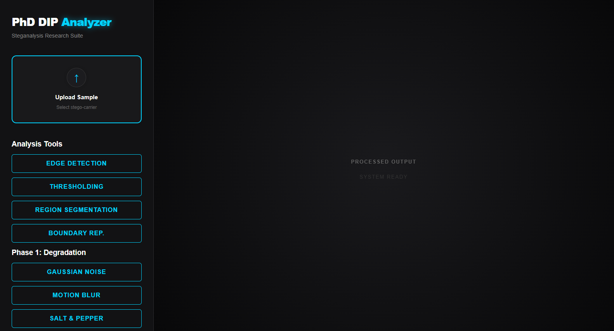
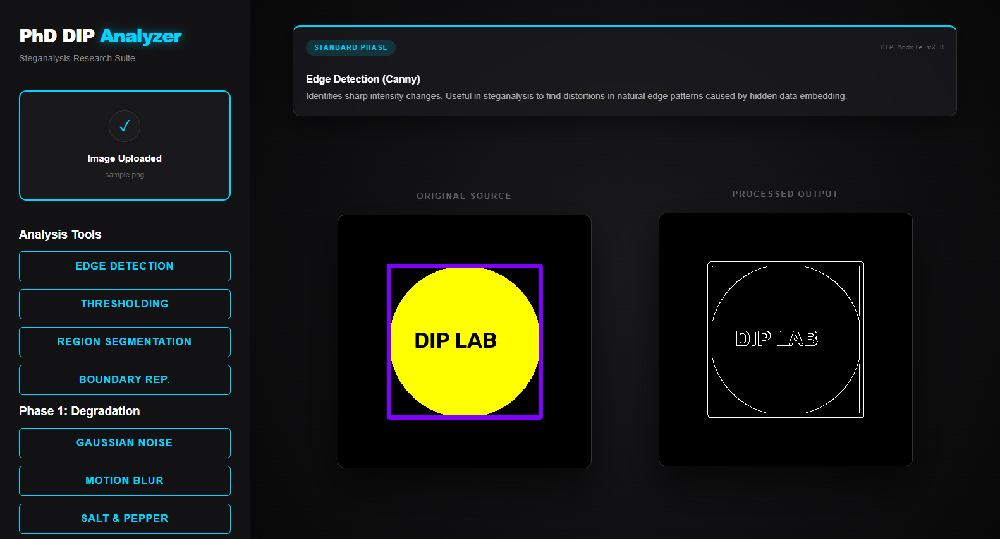
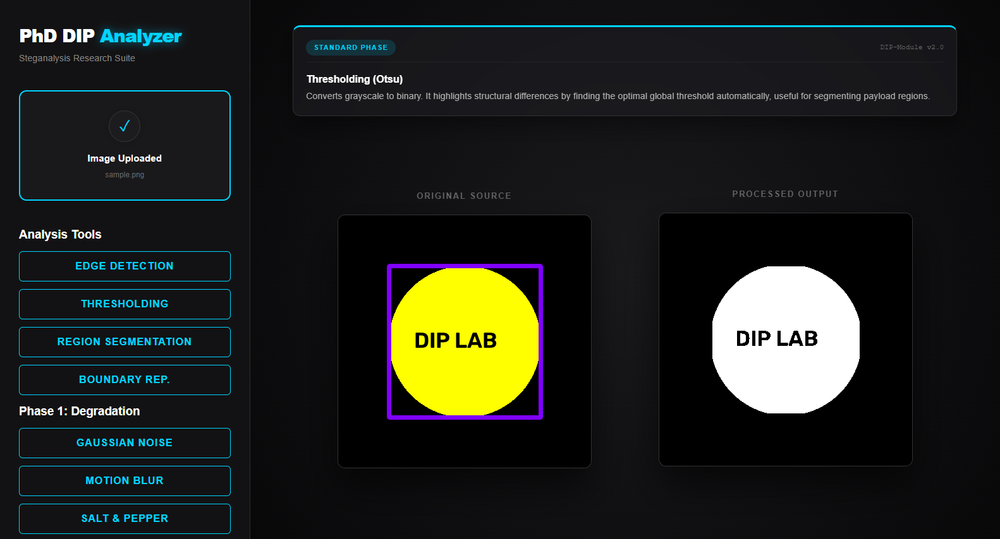

# DIP-Matrix-Lab

<p align="center">
  
  
  
  
  
  
</p>

An advanced Full-Stack Digital Image Processing (DIP) & Steganalysis Research Suite. Analyze carrier matrix structures, simulate stochastic degradation models, and execute adaptive image restoration pipelines in real time.

---

## 📸 Hero Preview

<p align="center">
  
</p>

## 🖼️ UI Snapshot Gallery

<p align="center">
  
  
</p>

---

## ✨ Features

- 🔬 **Real-Time DIP Analysis** - Canny edge detection, Otsu thresholding, connected component region segmentation, and boundary contour extraction.
- 🧪 **Degradation Modeling (Phase 1)** - Inject controlled Gaussian noise, directional motion blur, and salt-and-pepper noise to evaluate carrier robustness.
- 🛡️ **Forensic Restoration (Phase 2)** - Unlock non-linear Median filtering, inverse smoothing, and LMS / bilateral filters for artifact suppression.
- 🖥️ **Cyberpunk Matrix UI** - Dark sci-fi console layout featuring real-time laser scan overlays and instant side-by-side image comparisons.
- 📐 **Live Algorithm Insights** - In-depth mathematical explanations and forensic applications displayed with each transform.

---

## 🛠️ Tech Stack

- **Frontend**: React 19, Vite, Axios, Modern CSS Matrix Theme
- **Backend**: FastAPI, Uvicorn (Asynchronous REST API)
- **Computer Vision & Math**: OpenCV (C++ bindings via Python), NumPy

---

## 🚀 Quick Start

### 1. Clone the repository
```bash
git clone https://github.com/soorajstudio/DIP-Matrix-Lab.git
cd DIP-Matrix-Lab
```

### 2. Start Backend (FastAPI)
```bash
cd backend
pip install -r requirements.txt
uvicorn main:app --reload --port 8000
```

### 3. Start Frontend (React + Vite)
```bash
cd ../frontend
npm install
npm run dev
```

Open [http://localhost:5173](http://localhost:5173) in your browser.

---

## 📄 License

This project is licensed under the MIT License — see the [LICENSE](LICENSE) file for details.

Developed with ❤️ by [Sooraj Studio](https://github.com/soorajstudio).
